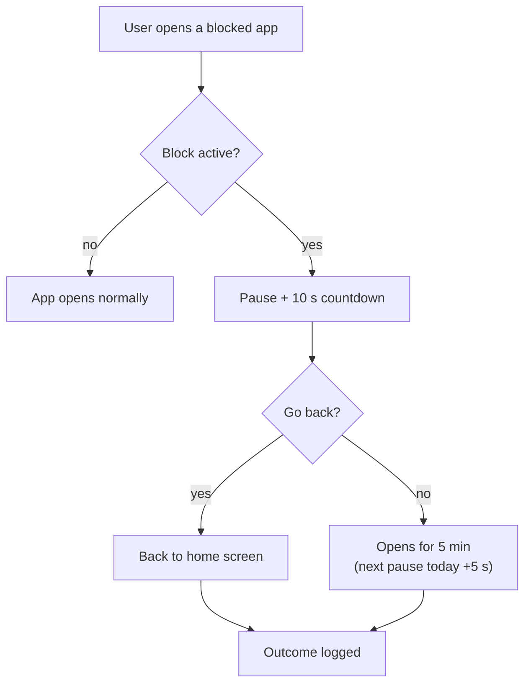
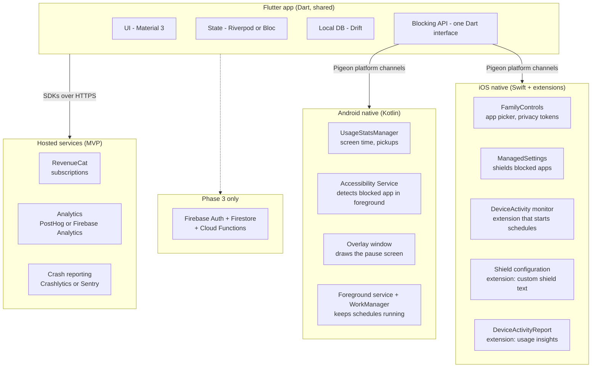
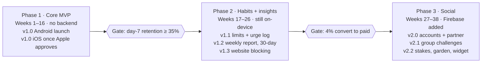

# Dopamine Detox App — Product Requirements Document

Nov 16, 2026 · Mark

> **Scope decisions in this version**
> - Phase 1 (MVP) runs with **no backend**: everything is on-device. The only hosted services are RevenueCat (subscriptions), analytics and crash reporting.
> - Firebase (Auth, Firestore, Cloud Functions) is added in **Phase 3** for social features.
> - Launch **Android first**; iOS follows once Apple approves the Family Controls entitlement.

---

## 1. Overview

A Flutter app for Android and iOS that helps people cut compulsive phone use. It does this by putting friction in front of distracting apps, running structured detox programs, and showing people what their habits actually cost them. The MVP targets a 7-day reset that a user can finish without turning the app off.

**Problem.** Short-form feeds and notifications are built to keep people scrolling. Most users want to cut back, but the built-in tools (Android Digital Wellbeing, iOS Screen Time) are easy to dismiss with one tap and give no structure or motivation.

**Vision.** The app should feel calm, not like another dopamine machine. It uses friction before force, short guided programs instead of open-ended willpower, and honest feedback on time won back.

**Working name:** TBD.

---

## 2. Goals, non-goals and success metrics

The MVP succeeds if users open distracting apps less often and keep using our app for at least a week.

**Goals**

- Cut daily pickups of blocked apps for active users.
- Get users through a 7-day reset program.
- Make the cost of scrolling visible through clear weekly insights.
- Build a habit loop (streaks, daily tasks) that doesn't depend on addictive mechanics.

**Non-goals for v1**

- Parental controls or managing someone else's device.
- Desktop or browser extension blocking.
- Medical or therapy claims.
- Social feeds or public profiles inside the app.

**Success metrics** (starting assumptions; revisit after the beta)

| Metric | Definition | Target |
| --- | --- | --- |
| Onboarding completion | Installs that grant permissions and set a first block | 60% |
| Day-7 retention | Users active on day 7 | 35% |
| 7-day reset completion | Users who start the program and finish day 7 | 25% |
| Blocked-app opens | Change in daily opens of blocked apps, week 1 vs week 2 | −30% |
| Friction turn-back rate | Intercepts where the user goes back instead of continuing | 40% |
| Free-to-paid conversion | Trial or free users who subscribe within 30 days | 4% |

---

## 3. Target users and personas

The primary user is a student or young professional, aged 18–35, who knows they scroll too much and has already tried, and dropped, the built-in screen time tools.

| Persona | Who they are | Main pain | What wins them |
| --- | --- | --- | --- |
| The distracted student | 19–24, exams and assignments, TikTok and Instagram heavy | Loses hours to "just 5 minutes" | Focus sessions, strict mode, streaks |
| The burned-out professional | 25–35, remote or hybrid work | Checks the phone between every task, feels foggy | Work-hours schedules, notification batching, weekly report |
| The night scroller | Any age, scrolls in bed | Poor sleep, late nights | Sleep mode, bedtime lock, morning no-phone task |
| The self-improver | Reads about habits and dopamine detox | Wants a structured program, not just a blocker | 7-day and 30-day challenges, journaling, insights |

---

## 4. User stories

1. As a user, I want to pick the apps that waste my time, so the app knows what to block.
2. As a user, I want a pause screen before a distracting app opens, so I can catch myself on autopilot.
3. As a user, I want blocks on a schedule (work hours, bedtime), so I don't have to remember to turn them on.
4. As a user, I want a strict mode I can't easily switch off, so I can't cheat in a weak moment.
5. As a user, I want a daily time limit per app, so I can still use Instagram without losing the evening to it.
6. As a user, I want a guided 7-day program, so I have a clear plan instead of relying on willpower.
7. As a user, I want to see my pickups and screen time trend, so I know whether I'm improving.
8. As a user, I want to log an urge and what triggered it, so I can spot my patterns.
9. As a user, I want a streak that survives one bad day, so a single slip doesn't make me quit.
10. As a user, I want a friend to be told if I break strict mode, so I have someone holding me to it.

---

## 5. Feature requirements

The MVP (P0) is six features: app selection, the friction screen, scheduled blocking, strict mode, the dashboard with streaks, and the 7-day reset. P1 ships in the first updates after launch; P2 comes once retention is proven.

### P0 — MVP

#### 5.1 Onboarding and app selection

- Explains the value in at most 3 screens, then asks for permissions, each with a one-line reason.
- Lists installed apps (Android) or opens the Screen Time picker (iOS), with popular distracting apps suggested.
- Asks one goal question (study, work, sleep, general) to pick a default schedule.
- **Done when:** a new user can set a first block in under 2 minutes.

#### 5.2 Friction screen (intercept)

- When a blocked app opens inside an active block, show a full-screen pause with a breathing countdown (default 10 s, adjustable 5–30 s).
- After the countdown, ask "Do you really want to open [app]?" with **Go back** as the main button and **Open for 5 min** as the secondary.
- Each "Open" makes the next countdown 5 s longer that day.
- Log every intercept and its outcome.
- **Done when:** the intercept appears within 500 ms of the app opening on Android, and every outcome is recorded.

#### 5.3 Scheduled blocking (focus modes)

- Users create modes (Work, Sleep, Custom) with a set of apps, days and time windows.
- Three templates ship by default: Work (Mon–Fri 9–17), Sleep (22:30–07:00), Morning (first hour after wake time).
- A manual "Focus now" session runs for 25, 50 or 90 minutes, or a custom length.
- **Done when:** schedules start and end on time after a device restart and with the app closed.

#### 5.4 Strict mode

- While a strict session runs, blocks can't be edited or turned off.
- The only early exit is an **emergency unlock**: a 60 s wait plus typing a sentence. It counts as a break and is logged.
- Optional (Android): uninstall protection via device admin, opt-in only. Consider deferring because of Play policy risk.
- **Done when:** there's no way to end a strict session early without the unlock flow.

#### 5.5 Dashboard and streaks

- Today: screen time, pickups and opens of blocked apps, plus intercepts turned back.
- Week: a daily trend chart and time saved vs. the user's first-week baseline, shown in real terms ("6 h = 3 movies").
- A streak counts days where the user stayed within their limits. One free streak freeze per week.
- **Done when:** the numbers match the OS usage data within 5% (Android). On iOS, insights are drawn by the DeviceActivityReport extension.

#### 5.6 7-day reset program

- One short task a day that builds up:
  - Day 1: set blocks
  - Day 2: no phone for the first 30 min after waking
  - Day 3: move distracting apps off the home screen
  - Day 4: notification cleanup
  - Day 5: a 2 h offline block
  - Day 6: phone outside the bedroom
  - Day 7: review and set the next goal
- A daily check-in (mood 1–5, one-line reflection).
- Completion screen with a week summary.
- **Done when:** users can pause and resume the program, and progress survives a reinstall through Android Auto Backup / iCloud key-value backup (no account needed).

### P1 — first updates after launch

| Feature | What it does |
| --- | --- |
| Per-app daily limits | Time budget per app (e.g. 30 min of Instagram), with a warning at 80% and a lock at 100% |
| Urge log | One-tap log with optional trigger (bored, stressed, lonely, habit) and time; feeds the insights |
| Weekly report | Sunday notification and screen: best day, worst hour, top trigger, time saved |
| Healthy swaps | The intercept screen suggests an offline activity from the user's own list |
| 30-day program | A longer program built from the 7-day reset |
| Website blocking | Blocks chosen domains (Android local VPN; iOS Screen Time web filter) |

### P2 — after retention is proven

| Feature | What it does |
| --- | --- |
| Accountability partner | Invite a friend by link; they're notified when strict mode is broken or a streak ends |
| Group challenges | Friends join a detox week together, with a shared board of time saved |
| Commitment stakes | User pledges an amount that goes to charity if they quit a program early |
| Notification batching (Android) | Holds non-urgent notifications and delivers them 2–3 times a day |
| Grow-a-garden visual | A plant that grows during focus time and wilts when strict mode is broken |
| Home-screen widget | Today's streak and time saved |

---

## 6. Key user flows

### 6.1 Onboarding (under 2 minutes)

1. Welcome: three short screens on what the app does and why friction works.
2. Goal question: study, work, sleep or general.
3. Pick distracting apps from the suggested list.
4. Grant permissions one at a time, each with a short reason.
5. Confirm the default schedule for the chosen goal.
6. Offer to start the 7-day reset today.

### 6.2 Starting a focus session

1. Tap "Focus now" on the home screen.
2. Choose a length (25, 50, 90 min or custom) and whether it's strict.
3. The session starts with a visible countdown and a persistent notification.
4. At the end, show time focused and intercepts turned back.

### 6.3 Blocked-app intercept

Outside a block the app stays out of the way. Inside one, the user always gets the pause, and each "open anyway" makes the next pause longer.

### 6.4 A program day

1. Morning notification with today's task.
2. The user reads the task and why it helps (under 30 seconds).
3. They mark it done during the day.
4. Evening check-in: mood 1–5 and a one-line reflection.
5. The streak updates, and tomorrow's task is shown.

---

## 7. Technical architecture

All UI, logic and data live in shared Flutter code. Blocking sits behind one Dart interface with a native implementation per platform, because neither platform exposes blocking to Dart.

### Platform differences to design for

- **Android:** The intercept is our own Flutter or native overlay, so the countdown and "open for 5 min" work exactly as specced. Background work must survive OEM battery savers.
- **iOS:** Apps are blocked with system shields. The shield screen can show custom text and buttons but can't run our countdown, so on iOS the pause happens inside our app: the shield's button opens our app, which runs the pause and then lifts the shield for 5 minutes.
- **iOS usage data** is only available inside a DeviceActivityReport extension. It can be shown to the user but not read by our app or sent to a server, so iOS insights are rendered by that extension.

### Suggested stack

| Layer | Choice | Phase |
| --- | --- | --- |
| State management | `flutter_riverpod` (or Bloc if that's what you already use) | 1 |
| Local storage | `drift` (SQLite) for logs, schedules and programs | 1 |
| Platform channels | `pigeon` for type-safe Dart ↔ Kotlin/Swift calls | 1 |
| Payments | `purchases_flutter` (RevenueCat) | 1 |
| Notifications | `flutter_local_notifications` | 1 |
| Charts | `fl_chart` | 1 |
| Analytics / crashes | PostHog or `firebase_analytics`; `firebase_crashlytics` or `sentry_flutter` | 1 |
| Backup | Android Auto Backup; iCloud key-value store (native) | 1 |
| Auth and sync | `firebase_auth`, `cloud_firestore` | 3 |
| Push | `firebase_messaging` | 3 |

---

## 8. Privacy, permissions and app store compliance

Usage data stays on the device. In Phase 3, the cloud syncs only program progress, streaks and settings. That's both the trust story and the easiest path through store review.

| Platform | Permission or entitlement | Why we need it | Review risk |
| --- | --- | --- | --- |
| Android | Usage access (`PACKAGE_USAGE_STATS`) | Screen time and pickup data | Low; needs a clear in-app explanation |
| Android | Accessibility Service | Detect a blocked app opening and show the intercept | High; Google Play requires a prominent disclosure and a policy declaration form, and may reject apps that misuse it |
| Android | Display over other apps (`SYSTEM_ALERT_WINDOW`) | Draw the intercept screen | Medium |
| Android | Device admin (optional) | Uninstall protection in strict mode | Medium; opt-in only |
| Android | VPN service (P1) | Website blocking | Medium; must declare that it's local only |
| iOS | Family Controls entitlement | Screen Time API: blocking, shields, usage reports | Apple has to approve the distribution entitlement; apply early |

**Data rules**

- No selling or sharing of usage data with advertisers. No third-party ad SDKs.
- Per-app usage stays on the device; analytics events carry counts, not app names.
- Data export (and, from Phase 3, account deletion) available from Settings.
- The privacy policy and the Play Data safety form must match these rules.

---

## 9. Monetization

Freemium with a subscription and no ads. Ads would contradict the product's whole promise. Prices are placeholders to test, not research-backed figures.

| Tier | Includes | Proposed price |
| --- | --- | --- |
| Free | Up to 3 blocked apps, 1 schedule, friction screen, today's dashboard, 7-day reset | $0 |
| Pro | Unlimited apps and schedules, strict mode, per-app limits, full history and weekly reports, 30-day program, website blocking | $4.99/month or $29.99/year, with a 7-day free trial |
| Lifetime (optional) | Pro forever, offered at launch and during sales | $59.99 one-time |

- Paywall moments: adding a 4th app, turning on strict mode, and the completion screen at the end of the 7-day reset.
- Use regional pricing in the stores for markets like South Asia.
- Use RevenueCat (or `in_app_purchase` directly) to handle subscriptions across both stores.

---

## 10. Analytics events

These events cover every success metric above. None of them carry app names or raw usage data.

| Event | Key properties | Feeds metric |
| --- | --- | --- |
| `onboarding_step_completed` | step, platform | Onboarding completion |
| `permission_granted` / `permission_denied` | permission type | Onboarding completion |
| `block_created` | type (schedule, focus now), app count | Onboarding completion |
| `intercept_shown` | countdown length, mode | Turn-back rate |
| `intercept_outcome` | went_back or opened, time to decide | Turn-back rate |
| `strict_session_started` / `strict_unlock_used` | duration | Engagement |
| `program_day_completed` | program, day number | Program completion |
| `streak_broken` / `streak_freeze_used` | streak length | Retention |
| `paywall_viewed` / `subscription_started` | trigger, plan | Conversion |
| `daily_summary` | blocked-app opens (count), pickups (count) | Blocked-app opens |

---

## 11. Three-phase roadmap and releases

The product ships in three phases over about 38 weeks: the core blocker first, deeper habit tools next, and social features last, which is when a backend is added. Each phase starts only once the live app meets the gate before it.

### Phase 1 — Core MVP (v1.0)

Goal: a complete blocker people keep using for a week. Everything stays on the device.

**Phase 1 build order (weeks)**

| Weeks | Work |
| --- | --- |
| 1–2 | Request the iOS Family Controls entitlement; project setup; Blocking API interface; Android usage stats |
| 3–8 | Friction screen, schedules, strict mode, dashboard and streaks |
| 9–11 | 7-day reset, onboarding, paywall, Play policy declarations |
| 12–14 | Closed beta (Play closed testing + TestFlight), 50–100 testers; fix top issues |
| 15–16 | Google Play launch; iOS once the entitlement is approved |

**App sections**

| Section | What's in it | Notes |
| --- | --- | --- |
| Onboarding | 3 intro screens, goal question, app picker, permission steps | iOS uses Apple's Screen Time app picker |
| Home | Today's status, active mode, "Focus now" button, streak | Main screen |
| Blocks | App list; modes and schedules (Work, Sleep, Morning, custom) | Free tier: 3 apps, 1 schedule |
| Friction screen | Countdown, go back or open for 5 min, longer pause after each open | iOS: system shield, then the pause runs in the app |
| Strict mode | Locked sessions, emergency unlock | Pro |
| Insights | Today and week views, time saved | iOS: drawn by the Screen Time report extension |
| Program | 7-day reset, daily task, mood check-in, completion screen | Free |
| Paywall | Free vs Pro, 7-day trial | RevenueCat |
| Settings | Permissions, countdown length, notifications, backup | Android Auto Backup and iCloud |

### Phase 2 — Habits and insights (v1.1–v1.3)

Goal: give users reasons to stay past the first week and to upgrade. Still no backend.

| Section | What's in it | Release |
| --- | --- | --- |
| Limits (new) | Daily time budget per app, warning at 80%, lock at 100% | v1.1 |
| Urge log (new) | One-tap log from Home and the friction screen, trigger tags | v1.1 |
| Insights: weekly report | Sunday report screen and notification: best day, worst hour, top trigger | v1.2 |
| Friction screen: healthy swaps | Suggests an offline activity from the user's own list | v1.2 |
| Programs library | 7-day and 30-day programs, pick the next one | v1.2 |
| Web blocking (new) | Blocked domains; Android local VPN, iOS web filter | v1.3 |

### Phase 3 — Social and accountability (v2.0–v2.2)

Goal: add other people as a reason to stick with it. Firebase (Auth, Firestore, Cloud Functions) comes in here.

| Section | What's in it | Release |
| --- | --- | --- |
| Account (new) | Sign-in, cloud sync across devices, data export and delete | v2.0 |
| Friends (new) | Invite link, accountability partner, alerts when strict mode is broken | v2.0 |
| Challenges (new) | Group detox weeks, shared board of time saved | v2.1 |
| Stakes (new) | Pledge an amount that goes to charity if the user quits early | v2.2; needs a payments and legal check |
| Garden (new) | A plant that grows during focus and wilts on emergency unlock | v2.2 |
| Home-screen widget | Streak and time saved | v2.2 |
| Notification batching | Holds non-urgent notifications, delivers 2–3 times a day | v2.2, Android only |

---

## 12. Risks and open questions

The biggest risks are store approval for the blocking permissions and users simply turning the app off.

| Risk | Impact | Mitigation |
| --- | --- | --- |
| Google Play rejects the Accessibility Service use | Android blocking breaks | Prominent disclosure, a narrow service config, a demo video for review; fall back to usage-stats polling plus an overlay |
| Apple delays the Family Controls entitlement | iOS launch slips | Apply in week 1; launch iOS with insights and programs only if it's late |
| Android OEM battery savers kill the background service | Intercepts and schedules stop working | Foreground service, a battery-optimization exemption prompt, per-brand guides (Xiaomi, Samsung, Oppo) |
| Users uninstall when blocks get annoying | Churn | Friction before hard blocks, adjustable countdowns, the streak freeze |
| Our own app turns into a dopamine loop | Undercuts the brand | No infinite feeds, few notifications, calm visuals |

**Open questions**

- [ ] Final app name and brand direction.
- [ ] Which markets to launch in first, and in which languages?
- [ ] Free-tier limits: is 3 blocked apps the right line?
- [ ] Keep or drop device-admin uninstall protection?
